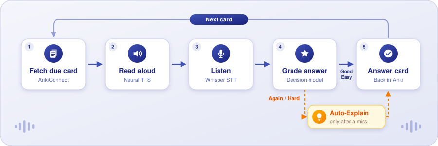
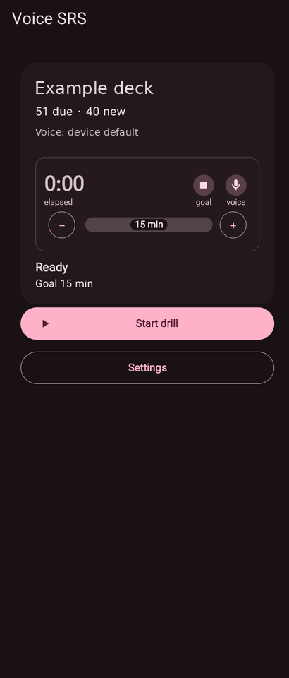
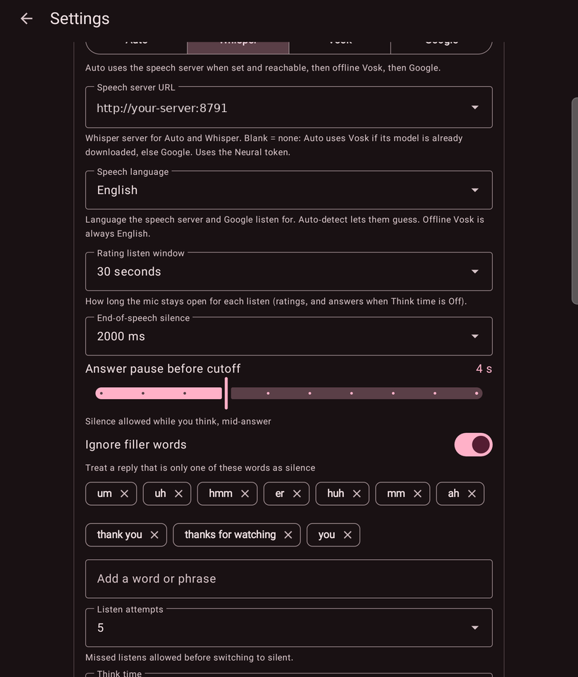
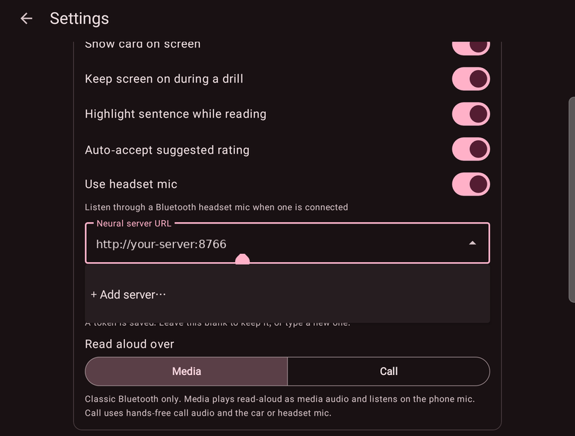
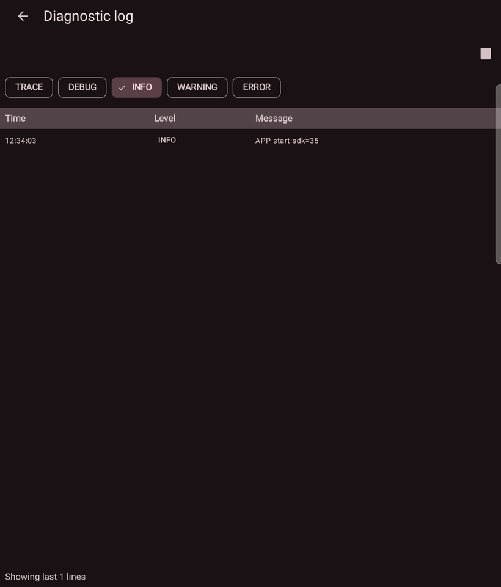

<p align="center">
  
</p>

<h1 align="center">Voice SRS</h1>

<p align="center"><b>Hands-free Anki reviews. Hear the card, say the answer, keep your streak.</b></p>

<p align="center">
  
  
  
  
</p>

<p align="center">
  <a href="#features">Features</a> ·
  <a href="#screenshots">Screenshots</a> ·
  <a href="#getting-started">Getting started</a> ·
  <a href="#security">Security</a>
</p>

---

Voice SRS is an experimental Android app for hands-free flashcard practice against your own Anki collection through AnkiConnect. It reads each card aloud, listens for your answer, grades it, and moves on, so you can review while walking, cooking or commuting.

## Features

<table>
<tr>
<td width="33%" valign="top"><h3>Voice drill loop</h3>Cards are read aloud, your spoken answer is captured, and the review advances without touching the screen.</td>
<td width="33%" valign="top"><h3>Whisper speech-to-text</h3>Point the app at a Whisper-compatible ASR server, with tunable end-of-speech and answer-pause timing.</td>
<td width="33%" valign="top"><h3>Neural read-aloud</h3>Natural voices from a neural TTS server, routed over the Media or Call audio channel.</td>
</tr>
<tr>
<td valign="top"><h3>Your own Anki</h3>Talks to a self-hosted Anki + AnkiConnect, so reviews land in your real collection and schedule.</td>
<td valign="top"><h3>Auto-Explain</h3>Optional OpenAI-compatible explanations after Again or Hard answers, plus a decision model for grading.</td>
<td valign="top"><h3>Built for daily use</h3>Session timer, in-app log viewer and export, backups, and saved-server dropdowns for every URL.</td>
</tr>
</table>

## How a drill works

<p align="center">
  
</p>

## Screenshots

<p align="center">
  
  
  
  
</p>

## Getting started

Requires JDK 17 and Android SDK 36. The app runs on Android 8.0 (API 26) and later.

```sh
./gradlew testDebugUnitTest assembleDebug
```

The debug APK is written to `app/build/outputs/apk/debug/`. Install Anki with AnkiConnect (a copy is in [`addon/`](addon)), then enter your AnkiConnect URL and any speech or AI servers in Settings. See [BUILD_NOTES.md](BUILD_NOTES.md).

## Security

Use HTTPS or another trusted private network, and never expose AnkiConnect directly to the internet. Secret-scan and dependency-audit commands are in [tools/security](tools/security/README.md). Test fixtures use invented data.

## License

A project license has not been selected yet. Vendored AnkiConnect code keeps its upstream notice.
